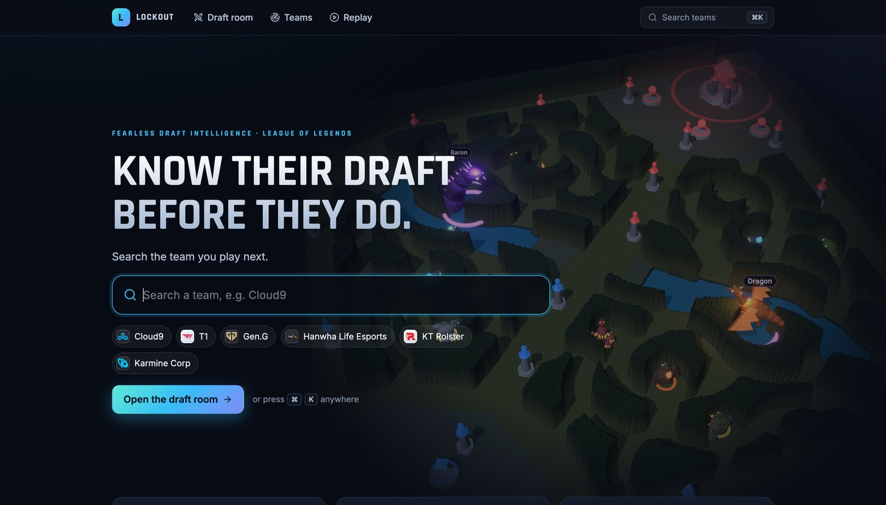
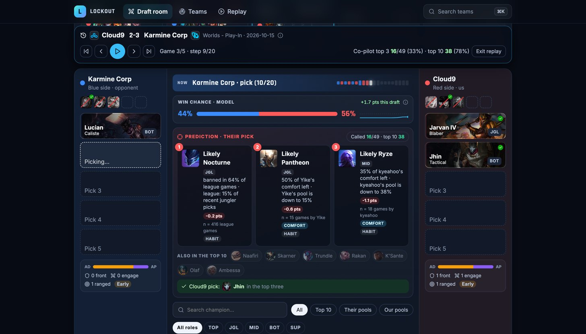
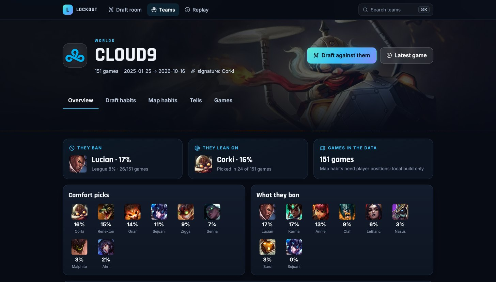
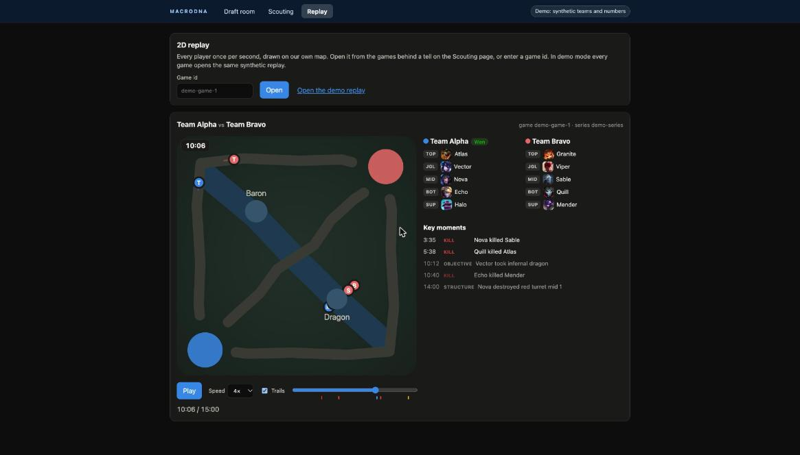
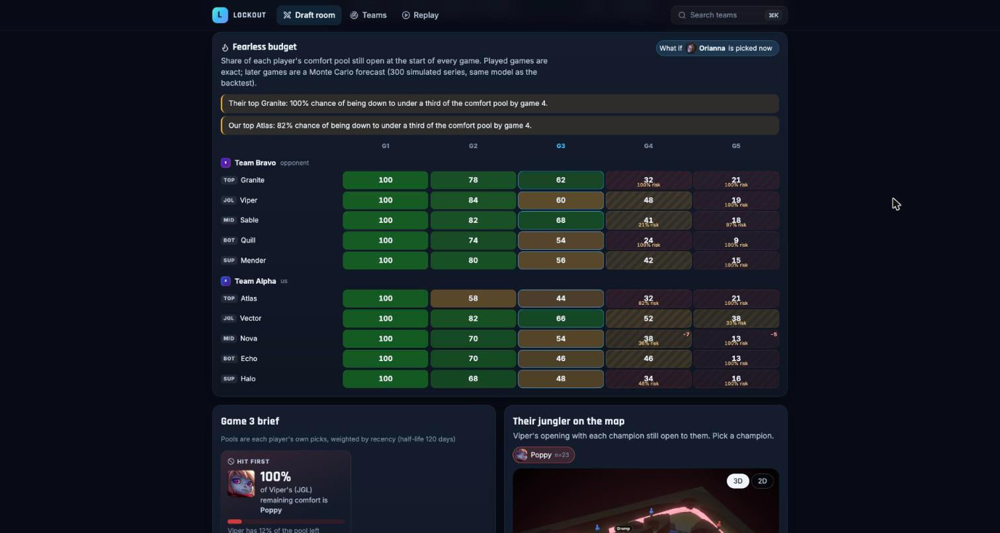
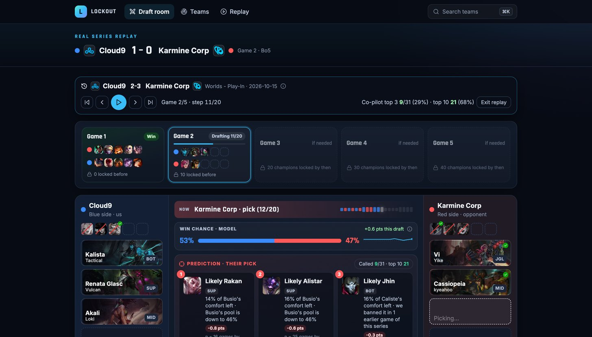

# Lockout

**Fearless draft preparation for League of Legends, grounded in how teams actually play.**
Entry for the *Cloud9 x JetBrains: Sky's The Limit Hackathon 2026*, Category 2 (LoL): Macro Scouting & Draft Management.

**[Open the live demo](https://znlong2203.github.io/lockout/)** (real teams and drafts from public Leaguepedia data, 2,789 pro games up to Worlds 2026; nothing to install) · [](https://github.com/ZNLong2203/lockout/actions/workflows/ci.yml)

In Fearless Draft every champion picked in a game is locked for the rest of the series, for **both** teams.
A player's comfortable pool shrinks game after game, and by game 3 or 4 some role is playing off its pool.
Coaches track this in spreadsheets. Lockout reads the official GRID feeds (745 series, 1,739 games) and answers:

- **What should we do on this exact step?** A **draft co-pilot** gives three moves at each of the 20 steps: the best ones for us on our turn, the likeliest ones for them on theirs. Each comes with a one-line reason and its sample size. A learned softmax ranker plus a LightGBM re-ranker had the real choice in its **top 10 shortlist 73 %** of the time, and in its top 3 cards **40 %** (bans 45 %). That is on the 80 most recent real series, held out from training, against 26 % top 3 for a league-meta baseline and about 2 % by chance ([how it was measured](docs/methodology.md#draft-co-pilot-step-by-step)).
- **Are we winning this draft?** A **live win chance** updates after every pick and shows how each suggested pick would move it. A logistic model on team Elo plus the draft, scored on the latest 430 games: **73.6 % right when it is confident** (65 %+, 40 % of games), 66.7 % over all games, AUC 0.69. The draft moves it by a few points, and the tooltip says so ([details](docs/methodology.md#live-draft-win-chance)).
- **Which of their roles runs out of champions first, and what would a ban take away?** A **Fearless budget** table shows every player's comfort pool game by game: exact for games played, a Monte Carlo forecast after. Hovering a champion shows what picking it now costs both teams in later games.
- **And ours?** The same view for our own lineup: which champions to save for game 3 or 4, plus a composition check (damage split, frontline, engage, range) under each side's picks.
- **Would it have worked?** **Replay a real series** draft by draft: the co-pilot sees only what was known before game 1, and every step it called gets a check mark.
- **What does that pick mean on the map?** A *macro bridge* from a jungle champion to how that jungler opens and where they show up first, from player trajectories.
- **What are their tells?** Evidence-backed conditional behaviours (objective trades, jungle start versus first objective, first gank by lane), compared with the league and corrected for multiple comparisons. Every tell opens the games behind it, and each game opens in a **2D or 3D replay** at the moment it was triggered, with fallen champions and their respawn timers, and the drakes, grubs, Herald, Baron and Atakhan on the map while they are up.
- **What repeats in their drafts?** Pick and ban habits tested against the league, what their bans aim at, and how their picks shift as a Fearless series goes on.

Every number carries its sample size, and the backtest is reported as it came out, including what it does *not* show.
See [docs/methodology.md](docs/methodology.md).

[](docs/img/home.jpg)

| Fearless draft room | Team page | 3D replay |
|---|---|---|
| [](docs/img/draft-room.jpg) | [](docs/img/team.jpg) | [](docs/img/replay.jpg) |
| **Fearless budget (what-if on hover)** | **Real series replay, scored step by step** | |
| [](docs/img/budget.jpg) | [](docs/img/series-replay.jpg) | |

*Screenshots show the public demo: real teams, players and drafts from Leaguepedia (CC BY-SA 3.0), nothing from the licensed data. Only the replay's movement and events are simulated, since only GRID has player positions. The API's own documentation page is in [docs/img/api-docs.jpg](docs/img/api-docs.jpg).*


## Run it

Requires Python 3.12+ with [uv](https://docs.astral.sh/uv/) and Node 20+.

**Just look around (no data needed).** Open the [live demo](https://znlong2203.github.io/lockout/): the draft features run on public Leaguepedia data (CC BY-SA 3.0), and the replay simulates positions, which only the licensed GRID data has. To run it locally: `cd web && npm install && npm run dev:static`. Or run the web app on its synthetic demo data:

```bash
cd web && npm install && npm run dev      # http://localhost:5173
```

**With the real data.**

```bash
# 1. Clone the hackathon data OUTSIDE this project (it is proprietary, never commit it)
git clone https://github.com/cloud9esports/stl-hackathon-2026-grid-starter.git ../stl-hackathon-2026-grid-starter

# 2. Install, build the local cache, run the detectors and the draft analysis
uv sync
uv run lockout doctor
uv run lockout etl
uv run lockout detect
uv run lockout draft-build
uv run lockout logos                     # optional: team logo URLs from Leaguepedia (no images stored)

# 3. Serve the API and open the app on it
uv run lockout serve                     # http://127.0.0.1:8000/docs
cd web && VITE_API=live npm run dev       # proxies /api to the server

# Or stay in the terminal
uv run lockout plan "Cloud9" "100 Thieves" --locked "Ezreal,Rumble,Orianna"
uv run lockout tendencies "Cloud9"
```

The data location is read from `STL_DATA_DIR` (default `../stl-hackathon-2026-grid-starter`). All derived data is
written to `private/cache/`, which is gitignored.

**In PyCharm**, the shared run configurations in `.run/` do all of the above (including "Full stack (API + web live)").

**The public demo data.** `uv run lockout public-build` downloads the drafts from Leaguepedia and builds a cache
with the same layout as the GRID one; `uv run lockout public-export` writes `web/public/data` for the static demo.

**Tests.** `uv run pytest` (Python, API and contract tests on synthetic data), `uv run ruff check src tests`,
`cd web && npm test && npm run build`. With the API running on the real data, `cd web && npm run eval:copilot` re-scores
the co-pilot on real series (aggregate rates only). The live-mode tree re-ranker is trained locally with
`uv sync --group ml`, `cd web && npm run export:features`, then `uv run lockout copilot-train`.

## Documentation

[Architecture](docs/architecture.md) · [Methodology](docs/methodology.md) · [Data audit](docs/data-audit.md) ·
[API contract](docs/api-contract.md) · [AI showcase](AI_SHOWCASE.md)

## Built with JetBrains

Built with **JetBrains Air** (Claude agent) inside **PyCharm**. Which tool did what: [AI_SHOWCASE.md](AI_SHOWCASE.md); the short case study: [docs/ai-workflow-story.md](docs/ai-workflow-story.md).

## Data license

The GRID data is proprietary, licensed for the hackathon only, and is **not** part of this repository.
This repo contains source code, documentation and aggregate results only.
Match data is provided by GRID. This project is not endorsed by Riot Games or Cloud9.

## License

[MIT](LICENSE), covering the source code only. It does not cover the GRID / Cloud9 hackathon data, which is proprietary, licensed separately and never part of this repository. The public demo data in `web/public/data` comes from Leaguepedia under CC BY-SA 3.0.
